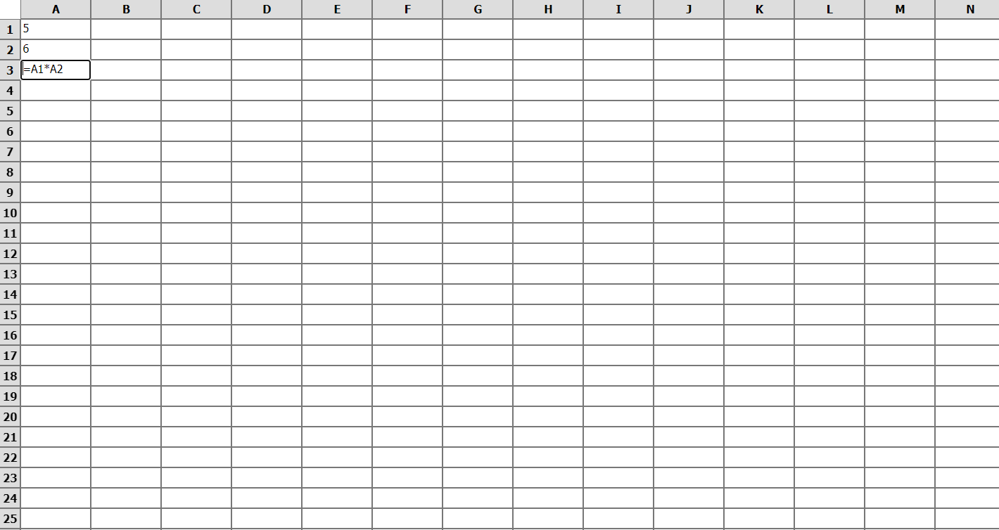

# Google Sheet Clone

A reactive, lightweight spreadsheet web application built with **Vue 3**, **Vite**, and **Pinia**. This project replicates the fundamental behavior of Google Sheets and Microsoft Excel, including coordinate indexing, dynamic formula computation, reactive cell dependency graphs, automatic grid expansion, and copy-paste compatibility with external spreadsheets.

[🔗 **Live Demo**](https://naazeri.github.io/google-sheet-clone/)

---

## 📸 Preview



---

## ✨ Features

- **📊 Dynamic Spreadsheet Grid**:
  - Excel-style alphanumeric coordinate system (`A`, `B`, ... `Z`, `AA`, `AB`, ...).
  - Starts with an initial 26 columns × 50 rows grid.
  - Built-in safety boundary protecting performance (maximum capacity of up to 16,000 cells).

- **🧮 Formula Engine & Calculation**:
  - Supports dynamic formulas starting with `=` (e.g., `=A1+B1`, `=(A1*2)+C3`).
  - Evaluates mathematical expressions using referenced cell values.
  - Handles invalid expressions gracefully with error fallbacks (`INVALID`).

- **⚡ Reactive Cell Dependency Graph**:
  - Leverages Pinia's `$onAction` subscriptions to listen for cell updates across the spreadsheet.
  - Modifying any referenced cell automatically triggers re-evaluation for all dependent formulas in real time.

- **📋 Spreadsheet Copy & Paste**:
  - Full clipboard support for tab-delimited (`\t`) and newline-separated (`\n`) tabular data copied directly from Google Sheets or Excel.
  - Intelligently spreads pasted content into adjacent rows and columns starting from the focused cell.

- **🔄 Automatic Grid Expansion**:
  - Auto-expands rows and columns as you approach table boundaries.
  - Automatically calculates and extends the grid dimensions if pasted data exceeds the current visible boundaries.

- **⚡ Fast & Modern Developer Experience**:
  - Powered by Vite 5 and Vue 3 Composition API (`<script setup>`).
  - Modular state management powered by Pinia.
  - UI styled with Vuetify 3 components.

---

## 🛠️ Tech Stack

| Technology | Description |
|---|---|
| **[Vue 3](https://vuejs.org/)** | Progressive JavaScript framework using Composition API (`<script setup>`) |
| **[Vite 5](https://vitejs.dev/)** | Next-generation frontend tooling and rapid HMR dev server |
| **[Pinia](https://pinia.vuejs.org/)** | Intuitive, type-safe state management for reactive cell data and grid dimensions |
| **[Vuetify 3](https://vuetifyjs.com/)** | Material Design component framework for Vue |
| **[Vue Router 4](https://router.vuejs.org/)** | Official client-side router (includes GitHub Pages compatibility route) |
| **[VueUse](https://vueuse.org/)** | Collection of essential Vue composition utilities |
| **ESLint & Prettier** | Code formatting and linting setup |

---

## 📁 Project Structure

```text
google-sheet-clone/
├── public/                 # Static assets
├── src/
│   ├── assets/             # CSS styles and project images
│   ├── components/
│   │   ├── AxisCell.vue    # Header cells for row numbers and column letters
│   │   └── CellItem.vue    # Individual interactive cell (contenteditable, formulas, paste handler)
│   ├── plugins/
│   │   └── vuetify.js      # Vuetify 3 configuration
│   ├── router/
│   │   └── index.js        # Vue Router routing rules
│   ├── stores/
│   │   └── cell.js         # Pinia store managing cell values, dimensions, and active cell state
│   ├── views/
│   │   ├── SheetsView.vue  # Main spreadsheet view rendering the grid
│   │   └── error/
│   │       └── NotFoundView.vue # 404 fallback page
│   ├── App.vue             # Root Vue component
│   ├── main.js             # Application entry point
│   └── utils.js            # Base-26 letter conversion, cell ID parsing & regex helpers
├── index.html              # HTML template
├── package.json            # Project dependencies and npm scripts
├── vite.config.js          # Vite configuration
└── README.md
```

---

## 🚀 Getting Started

### Prerequisites

- [Node.js](https://nodejs.org/) (version 18+ recommended)
- [pnpm](https://pnpm.io/) (or `npm`)

### Installation

Clone the repository and install dependencies:

```bash
# Using pnpm (recommended)
pnpm install

# Or using npm
npm install
```

### Development

Run the development server with Hot Module Replacement (HMR):

```bash
# Using pnpm
pnpm dev

# Or using npm
npm run dev
```

The application will be accessible at `http://localhost:5173` (or the port specified by Vite in your terminal).

### Production Build

Compile and minify the project for production:

```bash
# Using pnpm
pnpm build

# Or using npm
npm run build
```

Preview the production build locally:

```bash
pnpm preview
# or
npm run preview
```

### Linting & Formatting

```bash
# Lint and fix files
pnpm lint

# Format code with Prettier
pnpm format
```

---

## 💡 How It Works

1. **Coordinate System**:
   - `utils.js` provides `numberToLetters()` and `lettersToNumber()` to translate numeric column indices (0-indexed) into alphanumeric column names (`0 -> A`, `25 -> Z`, `26 -> AA`).
2. **Cell State & Formulas**:
   - Each cell maintains both a `rawValue` (what the user typed, e.g. `=A1+5`) and an `evaluatedValue` (the computed result).
   - In edit mode, the raw value is shown. When editing finishes or focus leaves the cell, the evaluated value is displayed.
3. **Reactive Re-calculation**:
   - When a cell finishes editing, its dependents are triggered via Pinia's `$onAction` listener. All formulas referencing the updated cell ID are re-evaluated immediately.
4. **Copy-Paste Integration**:
   - When pasting data containing tabs (`\t`) or line breaks (`\n`), the app automatically splits the payload into a matrix and writes values across the corresponding rows and columns in the store.

---

## 📝 License

This project is open-source and available under the MIT License.
